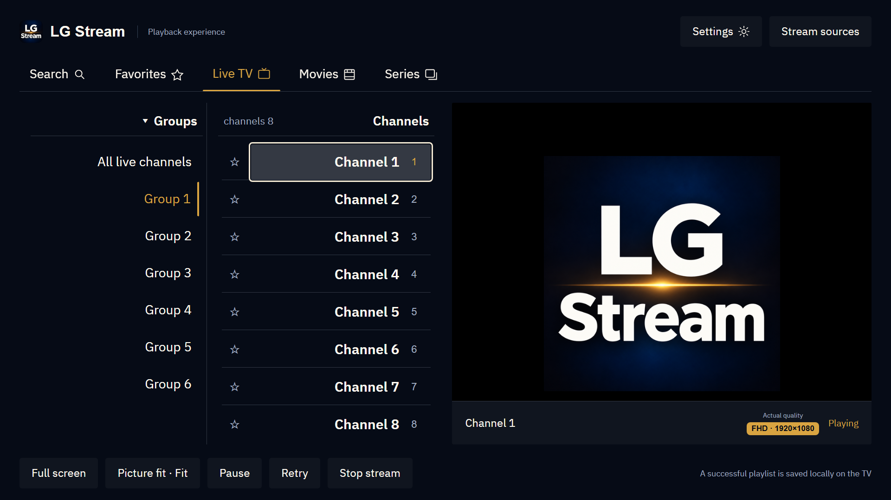

# LG Stream

مشغّل لقنوات البث والأفلام والمسلسلات على تلفزيونات LG بنظام webOS. يركز على سرعة التنقل بالريموت، وثبات التشغيل، والحفاظ على جودة الصورة والصوت التي يدعمها التلفزيون ومسار الصوت المتصل به.

A player for live TV, movies and series on LG webOS televisions. It focuses on responsive remote navigation, reliable playback, and the picture and audio formats supported by the television and connected audio equipment.

## واجهة التطبيق / Interface

لقطات من واجهة التطبيق بأسماء قنوات ومجموعات فرضية، ومنطقة الفيديو تعرض شعار التطبيق للمعاينة.

Screenshots use fictional group and channel names. The video area displays the app logo as a preview.

العربية / Arabic

English / الإنجليزية

## المزايا بالعربية

- شاشة «مصادر البث»: إضافة رابط M3U أو حساب Xtream، وتسمية المصدر وإيقافه وحذفه، وتحديث يدوي أو تلقائي كل 24 ساعة بشريط تقدم دون تجميد الريموت. تُحفظ القائمة وإعداداتها محليًا على التلفزيون.
- القنوات والمجموعات الجديدة من المزود تظهر أولًا، مع مجموعة «جديد».
- الزر الأزرق على أي قناة أو مجموعة: تحديد متعدد، نقل، إعادة تسمية، إخفاء، مع تأكيد قبل الحفظ. ومن الإعدادات «إدارة القنوات والمجموعات» لترتيبها وإظهار المخفي وإعادة الضبط. ترتيب واحد ينعكس على كل العروض والترقيم.
- تصفح القنوات والأفلام والمسلسلات، والبحث في المحتوى، وإدارة المفضلة وإخفاء المجموعات.
- واجهة عربية وإنجليزية. تُختصر الأسماء العربية وتُنظّم المجموعات المتشابهة مع الحفاظ على اختصارات العلامات، وتظهر أسماء المزود الأصلية في القوائم الإنجليزية.
- تصفية القنوات حسب النوع، مثل الرياضة والأفلام والأخبار والأطفال، وترقيم القائمة المعروضة من 1 داخل كل مجموعة أو فلتر.
- عرض جودة الفيديو الفعلية المقاسة من أبعاده، في مساحة منفصلة عن اسم القناة.
- تبديل ملاءمة الصورة مباشرة، وبطاقة قناة ثابتة أعلى اليمين لمدة 6 ثوانٍ عند التبديل.
- التحكم بالتشغيل ومسارات الصوت والترجمة وفق ما يتيحه المصدر والتلفزيون.

يصل التلفزيون إلى مصدر البث مباشرة أثناء المشاهدة. يضيف المستخدم مصادره من داخل التطبيق، ويُحفظ الكتالوج وإعداداته على الجهاز.

## Features in English

- A Streaming sources screen: add an M3U link or an Xtream account, name, pause or delete the source, and refresh manually or automatically every 24 hours with a progress bar while the remote stays responsive. The catalogue and its settings stay locally on the TV.
- New channels and groups from the provider appear first, with a "New" group.
- The blue button on any channel or group: multi-select, move, rename and hide, with a confirmation before saving. Settings → "Manage channels and groups" arranges them, shows hidden items and resets. One order drives every view and the numbering.
- Browse live channels, movies and series, search content, manage favorites, and hide groups.
- Switch between Arabic and English. Arabic labels are shortened and organized while preserving brand abbreviations. English catalogue rows show the provider's original names.
- Filter channels by categories such as sports, movies, news and kids. Each displayed group or filtered list starts numbering at 1.
- View actual video quality measured from decoded dimensions, separately from the channel name.
- Cycle picture fit directly and see a six-second channel announcement fixed at the top right.
- Use playback controls and select audio or subtitle tracks when available through the source and TV.

Playback connects directly from the TV to the source. Users add their own sources in the app, and the catalogue and settings stay on the device.

## الحالة الحالية / Current status

الإصدار الحالي [0.8.12](https://github.com/amjadoh/lg-stream/releases/tag/v0.8.12)، وهو مثبت ومجرب على LG OLED55CS6LA. دُمجت تحديثاته في الفرع الرئيسي عبر [طلب المراجعة 9](https://github.com/amjadoh/lg-stream/pull/9). يركز على ثبات البث وسرعة التنقل: فلاتر وبحث أسرع، وإعادة اتصال تلقائية محدودة للبث المباشر، وسجل انقطاعات في شاشة القياسات.

اجتازت هذه النسخة 40 اختبار منطق وبرامج الواجهة الستة، وفحوصًا قصيرة على التلفزيون: تشغيل مستقر لمدة 60 ثانية بلا توقف أو خطأ، وعودة قناة رفضها المزود مؤقتًا في المحاولة التلقائية الثالثة. الفحوص قصيرة، والثبات الطويل يُقاس بالاستخدام الفعلي.

The current release is [0.8.12](https://github.com/amjadoh/lg-stream/releases/tag/v0.8.12), installed and tested on LG OLED55CS6LA. Its updates were merged into main through [pull request 9](https://github.com/amjadoh/lg-stream/pull/9). It focuses on stable playback and fast navigation: faster filters and search, a bounded automatic reconnect for live channels, and an interruption log in the diagnostics screen.

This version passed 40 logic tests, all six UI programs and short TV checks: 60 seconds of steady playback with no waits or errors, and a channel temporarily rejected by the provider recovered on the third automatic attempt. The checks are short; long-term stability is measured through real use.

## التثبيت والتوثيق / Installation and documentation

تُبنى حزمة IPK عبر GitHub Actions، وتُثبت على التلفزيون باستخدام Developer Mode. تحتاج جلسة Developer Mode إلى التجديد حسب إعدادات LG.

The IPK package is built through GitHub Actions and installed on the TV using Developer Mode. Renew the Developer Mode session according to LG's settings.

- [قدرات الجهاز وحدود الصيغ / Device capabilities and media formats](docs/DEVICE_CAPABILITIES.md)
- [التسليم ونتائج التحقق / Handoff and verification](docs/HANDOFF.md)
- [نقطة الاستكمال / Continuation guide](docs/NEXT_SESSION.md)
