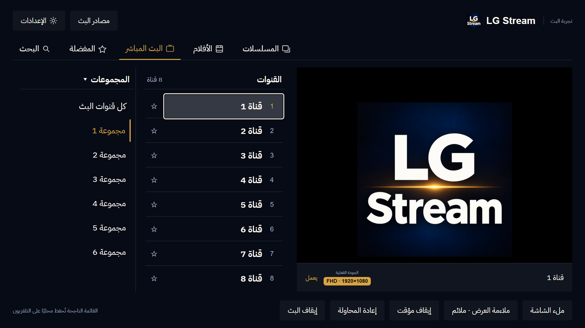

# LG Stream

مشغّل لقنوات البث والأفلام والمسلسلات على تلفزيونات LG بنظام webOS. يركز على سرعة التنقل بالريموت، وثبات التشغيل، والحفاظ على جودة الصورة والصوت التي يدعمها التلفزيون ومسار الصوت المتصل به.

## واجهة التطبيق

لقطات من واجهة التطبيق بأسماء قنوات ومجموعات فرضية، ومنطقة الفيديو تعرض شعار التطبيق للمعاينة.

العربية

English

## تجربة الاستخدام

- إضافة قائمة M3U من إعدادات المصادر، وحفظ آخر قائمة ناجحة وإعداداتها محليًا على التلفزيون.
- تصفح القنوات والأفلام والمسلسلات، والبحث في المحتوى، وإدارة المفضلة وإخفاء المجموعات.
- واجهة عربية وإنجليزية. تُختصر الأسماء العربية وتُنظّم المجموعات المتشابهة مع الحفاظ على اختصارات العلامات، وتظهر أسماء المزود الأصلية في القوائم الإنجليزية.
- تصفية القنوات حسب النوع، مثل الرياضة والأفلام والأخبار والأطفال، وترقيم القائمة المعروضة من 1 داخل كل مجموعة أو فلتر.
- عرض جودة الفيديو الفعلية المقاسة من أبعاده، في مساحة منفصلة عن اسم القناة.
- تبديل ملاءمة الصورة مباشرة، وبطاقة قناة ثابتة أعلى اليمين لمدة 6 ثوانٍ عند التبديل.
- التحكم بالتشغيل ومسارات الصوت والترجمة وفق ما يتيحه المصدر والتلفزيون.

يصل التلفزيون إلى مصدر البث مباشرة أثناء المشاهدة. يضيف المستخدم مصادره من داخل التطبيق، ويُحفظ الكتالوج وإعداداته على الجهاز.

## الحالة الحالية

الإصدار الحالي [0.8.10](https://github.com/amjadoh/lg-stream/releases/tag/v0.8.10)، وهو مثبت ومجرب على LG OLED55CS6LA. دُمجت تحديثاته في الفرع الرئيسي عبر [طلب المراجعة 8](https://github.com/amjadoh/lg-stream/pull/8). يستمر تطوير التطبيق بناءً على نتائج الاستخدام الفعلي.

اجتازت هذه النسخة اختبارات المنطق والواجهة، وفحوصًا قصيرة على التلفزيون. تأكد أثر تكبير الصورة بالمشاهدة، وثبات موضع بطاقة القناة بالقياس. تستمر متابعة حالات الانقطاع المتقطع، وتُسجل نتائج الصوت وصيغ العرض بحسب التجربة الفعلية لكل مصدر وجهاز.

## التثبيت والتوثيق

تُبنى حزمة IPK عبر GitHub Actions، وتُثبت على التلفزيون باستخدام Developer Mode. تحتاج جلسة Developer Mode إلى التجديد حسب إعدادات LG.

- [حالة الجهاز وحدود صيغ الفيديو والصوت](docs/DEVICE_CAPABILITIES.md)
- [آخر تسليم ونتائج التحقق](docs/HANDOFF.md)
- [نقطة الاستكمال الحالية](docs/NEXT_SESSION.md)
